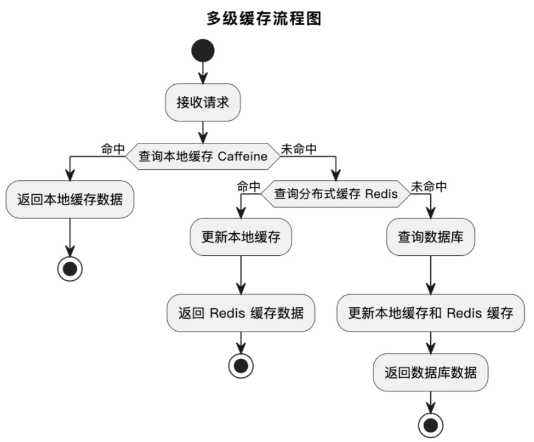

# 抓取图片

## 从哪里抓取

绝大多数的图片素材网站，都是有版权保护的，不建议操作，容易被封禁IP和账号。比较安全的方法是从搜
索引擎中抓取图片，仅学习使用、不商用的话基本不会有什么风险。
这里我们选择从bing搜索获取图片，首先进入bing图片网站（https://cn.bing.com/images/search?q=%e4%b8%96%e7%95%8c%e6%97%85%e6%b8%b8%e8%83%9c%e5%9c%b0&form=HDRSC2&first=1），可以看到很多图片，但是如何获取这些图片呢？

## 怎么抓取

### 两种方法

1. 请求到完整的页面内容后，对页面的HTML结构进行解析，提取到图片的地址，再通过URL下载；
2. 直接调用后端获取图片地址的接口拿到图片数据。

要使用哪种方式，还是要具体情况具体分析，比如在调研过程中，我们会发现直接从bing图片的首页抓取数据，

可能会出现获取不到图片的情况。所以我们换一种策略，尝试去找图片接口。

按F12打开网络请求控制台，向下滚动图片时会触发新一波图片的加载，就能看到获取图片数据的接口了：http

s://cn.bing.com/images/async?q=%s&mmasync=1

> [!CAUTION]

但是该接口返回的还是HTML文档结构，所以我们需要使用一个HTML文档解析库来提取图片地址，Java中比较
推荐jsoup（https://jsoup.org/），非常地轻量。

> jsoup支持使用跟前端一致的选择器语法来定位HTML的元素，比如类选择器、CSS选择器。我们可以先通过类
> 选择器找到最外层的元素dgControl，再通过CSS选择器img.mimg找到所有的图片元素


> [!CAUTION]
>
> 图片的地址后面有很多附加参数，比如？w=199&h=180，在导入图片时一定要移除！否则会影响图片的质
> 量，还有可能导致上传到对象存储的文件包含被转义的特殊字符，引发无法访问等问题。

## 抓取和导入规则

在抓取时可以添加如下两个参数：

- 搜索关键词：便于找到需要的数据
- 抓取数量：单次要抓取的条数，建议不超过30条（接口单次返回的图片有限）

## 功能开发

1. 引入jsoup（html解析库）

   引入maven

   ```xml
   <dependency>
       <!-- jsoup HTML parser library @ https://jsoup.org/ -->
       <groupId>org.jsoup</groupId>
       <artifactId>jsoup</artifactId>
       <version>1.21.2</version>
   </dependency>
   ```

2. controller层代码

   ```java
   /**
    * 批量抓取并创建图片
    * @param pictureUploadByBatchRequest
    * @param request
    * @return
    */
   @PostMapping("/upload/batch")
   @AuthCheck(mustRole = UserConstant.ADMIN_ROLE)
   public BaseResponse<Integer> uploadPictureByBatch(@RequestBody PictureUploadByBatchRequest pictureUploadByBatchRequest, HttpServletRequest request) {
       ThrowUtils.throwIf(pictureUploadByBatchRequest == null, ErrorCode.PARAMS_ERROR);
       User loginUser = userService.getLoginUser(request);
       int uploadCount = pictureService.uploadPictureByBatch(pictureUploadByBatchRequest, loginUser);
       return ResultUtils.success(uploadCount);
   }
   ```

3. service层代码

   ```java
   /**
    * 批量抓取和创建图片
    * @param pictureUploadByBatchRequest
    * @param loginUser
    * @return
    */
   @Override
   public Integer uploadPictureByBatch(PictureUploadByBatchRequest pictureUploadByBatchRequest, User loginUser) {
       // 校验参数
       String searchText = pictureUploadByBatchRequest.getSearchText();
       Integer count = pictureUploadByBatchRequest.getCount();
       ThrowUtils.throwIf(count > 30, ErrorCode.PARAMS_ERROR, "最多 30 条");
       // 获取文件前缀，默认为搜索关键词
       String namePrefix = pictureUploadByBatchRequest.getNamePrefix();
       if (StrUtil.isBlank(namePrefix)) {
           namePrefix = searchText;
       }
       // 抓取内容(通过q参数接收 searchText，实现动态改变)
       String fetchUrl = String.format("https://cn.bing.com/images/async?q=%s&mmasync=1", searchText);
       Document document;
       try {
           document = Jsoup.connect(fetchUrl).get();
       } catch (IOException e) {
           throw new BusinessException(ErrorCode.OPERATION_ERROR, "获取页面失败");
       }
       // 解析内容
       Element div = document.getElementsByClass("dgControl").first();
       if (ObjUtil.isEmpty(div)) {
           throw new BusinessException(ErrorCode.OPERATION_ERROR, "获取元素失败");
       }
       Elements imgElementList = div.select("img.mimg");
       // 遍历元素，依次处理上传图片
       int uploadCount = 0;
       for (Element imgElement : imgElementList) {
           String fileUrl = imgElement.attr("src");
           if (StrUtil.isBlank(fileUrl)) {
               log.info("当前连接为空，已跳过：{}", fileUrl);
               continue;
           }
           // 处理图片地址，防止转义或者和对象存储冲突的问题
           int questionMarkIndex = fileUrl.indexOf("?");
           if (questionMarkIndex > -1) {
               fileUrl = fileUrl.substring(0, questionMarkIndex);
           }
           // 上传图片
           PictureUploadRequest pictureUploadRequest = new PictureUploadRequest();
           pictureUploadRequest.setFileUrl(fileUrl);
           pictureUploadRequest.setPicName(namePrefix + (uploadCount + 1));
           try{
               PictureVO pictureVO = this.uploadPicture(fileUrl, pictureUploadRequest, loginUser);
               log.info("图片上传成功，id = {}", pictureVO.getId());
               uploadCount++;
           } catch (Exception e) {
               log.error("图片上传失败", e);
               continue;
           }
           if (uploadCount >= count) {
               break;
           }
       }
       return uploadCount;
   }
   ```

# 图片优化

## 查询优化

什么样数据适合缓存？“读多写少”，频繁查询不怎么修改的

具体来说：
1.高频访问的数据：如系统首页、热门推荐内容等。
2.计算成本较高的数据：如复杂查询结果、大量数据的统计结果。
3.允许短时间延迟的数据：如不需要实时更新的排行榜、图片列表等。

### Redis分布式缓存

> 分布式缓存是指将缓存数据分布存储在**多台服务器**上，以便在高并发场景下提供更高的吞吐量和更好的容错性。
> Redis是实现分布式缓存的主流方案，也是后端开发必学的技能。主要是由于它具有下面几个优势：
>
> - 高性能：基于内存操作，访问速度极快。**单节点Redis的读写QPS可达10w次每秒！**
> - 丰富的数据结构：支持字符串、列表、集合、哈希、位图等，适用于各种数据结构存储。
> - 分布式支持：可以通过RedisCluster构建高可用、高性能的分布式缓存，还提供哨兵集群机制提升可用性、
>   提供分片集群机制提高可扩展性。

#### 缓存设计

> 需要缓存首页的图片列表数据，也就是对listPictureVOByPage接口进行缓存。首先按照缓存3要素“key、value
> 、过期时间”进行设计。

1. 缓存key设计

   由于接口支持传入不同的查询条件，对应的数据不同，因此需要将查询条件作为缓存key的一部分。可以将查询条件对象转换为JSON字符串，但这个JSON会比较长，可以利用哈希算法（md5）来压缩key。此外，由于使用分布式缓存，可能由多个项目和业务共享，因此需要在key的开头拼接前缀进行隔离。设计出的key 如下：

   ```
   yupicture:listPictureVOByPage:${查询条件key}
   ```

2. 缓存value设计
   缓存从数据库中查到的Page分页对象，存储为什么格式呢？这里有2种选择：

   - 为了可读性，可以转换为JSON结构的字符串
   - 为了压缩空间，可以存为二进制等其他结构

   但是对应的Redis数据结构都是string。

3. 缓存过期时间设置
   **必须设置缓存过期时间！**根据实际业务场景和缓存空间的大小、数据的一致性的要求设置，合适即可，此处由
   于查询条件较多、而且考虑到图片会持续更新，设置为5～60分钟即可。

#### 如何操作redis

Java 中有非常多的 Redis 操作库，比如Jedis、Lettuce等。

为了便于和Spring项目集成，Spring还提供了Spring Data Redis作为操作Redis的更高层抽象（默认使用Lettuce作为底层客户端）。由于我们的项目使用SpringBoot，也推荐使用Spring Data Redis，开发成本更低。它的使用也非常简单，我们直接上手项目实战。

#### 后端开发

1. 引入依赖

   ```xml
   <!-- Redis -->
   <dependency>
       <groupId>org.springframework.boot</groupId>
       <artifactId>spring-boot-starter-data-redis</artifactId>
   </dependency>
   ```

2. 在application.yml中添加配置

   ```yml
   #redis配置
   redis:
     database: 1
     host: 127.0.0.1
     port: 6379
     password: 123456
     timeout: 5000
   ```

3. 编写测试文件`RedisStringTest`，对redis的增删改查进行测试

   ```java
   package com.yupi.yupicturebackend;
   
   import org.junit.jupiter.api.Test;
   import org.springframework.beans.factory.annotation.Autowired;
   import org.springframework.boot.test.context.SpringBootTest;
   import org.springframework.data.redis.core.StringRedisTemplate;
   import org.springframework.data.redis.core.ValueOperations;
   
   import static org.junit.jupiter.api.Assertions.*;
   
   @SpringBootTest
   public class RedisStringTest {
   
       @Autowired
       private StringRedisTemplate stringRedisTemplate;
   
       @Test
       public void testRedisStringOperations() {
           // 获取操作对象
           ValueOperations<String, String> valueOps = stringRedisTemplate.opsForValue();
   
           // Key 和 Value
           String key = "testKey";
           String value = "testValue";
   
           // 1. 测试新增或更新操作
           valueOps.set(key, value);
           String storedValue = valueOps.get(key);
           assertEquals(value, storedValue, "存储的值与预期不一致");
   
           // 2. 测试修改操作
           String updatedValue = "updatedValue";
           valueOps.set(key, updatedValue);
           storedValue = valueOps.get(key);
           assertEquals(updatedValue, storedValue, "更新后的值与预期不一致");
   
           // 3. 测试查询操作
           storedValue = valueOps.get(key);
           assertNotNull(storedValue, "查询的值为空");
           assertEquals(updatedValue, storedValue, "查询的值与预期不一致");
   
           // 4. 测试删除操作
           stringRedisTemplate.delete(key);
           storedValue = valueOps.get(key);
           assertNull(storedValue, "删除后的值不为空");
       }
   }
   ```

4. 编写缓存端口

   ```java
   /**
    * 分页获取图片列表（封装类，有缓存）
    */
   @PostMapping(&quot;/list/page/vo/cache&quot;)
   public BaseResponse&lt;Page&lt;PictureVO&gt;&gt; listPictureVOByPageWithCache(@RequestBody PictureQueryRequest pictureQueryRequest,
                                                            HttpServletRequest request) {
   
       long current = pictureQueryRequest.getCurrent();
       long size = pictureQueryRequest.getPageSize();
       // 限制爬虫
       ThrowUtils.throwIf(size &gt; 20, ErrorCode.PARAMS_ERROR);
       // 普通用户迷人智能看到审核通过的数据
       pictureQueryRequest.setReviewStatus(PictureReviewStatusEnum.PASS.getValue());
   
       // 查询缓存，缓存中没有再查询数据库
       // 构建缓存的 key
       String queryCondition = JSONUtil.toJsonStr(pictureQueryRequest);
       String hashKey = DigestUtils.md5DigestAsHex(queryCondition.getBytes());
       String redisKey = String.format(&quot;yupicture:listPictureVOByPage:%s&quot;, hashKey);
       // 操作redis，从缓存中查询
       ValueOperations&lt;String, String&gt; opsForValue = stringRedisTemplate.opsForValue();
       String cachedValue = opsForValue.get(redisKey);
       if (cachedValue != null) {
           // 如果缓存中有数据，则直接返回
           Page&lt;PictureVO&gt; cachedPage = JSONUtil.toBean(cachedValue, Page.class);
           return ResultUtils.success(cachedPage);
       }
   
       // 查询数据库
       Page&lt;Picture&gt; picturePage = pictureService.page(new Page&lt;&gt;(current, size),
               pictureService.getQueryWrapper(pictureQueryRequest));
       Page&lt;PictureVO&gt; pictureVOPage = pictureService.getPictureVOPage(picturePage, request);
       // 存入redis缓存
       String cacheValue = JSONUtil.toJsonStr(pictureVOPage);
       // 设置缓存的过期时间，5~10分钟（避免缓存雪崩）
       int cacheExpireTime = RandomUtil.randomInt(5, 10) * 60;
       opsForValue.set(redisKey, cacheValue, cacheExpireTime, TimeUnit.SECONDS);
   
       // 获取封装类
       return ResultUtils.success(pictureVOPage);
   }C
   ```

### caffeine本地缓存

https://github.com/ben-manes/caffeine

> 当应用需要频繁访问某些数据时，可以将这些数据缓存到应用的内存中（比如JVM中）；下次访问时，直接从内
> 存读取，而不需要经过网络或其他存储系统。
> 相比于分布式缓存，本地缓存的速度更快，但是无法在多个服务器间共享数据、而且不方便扩容。

所以本地缓存的应用场景一般是：

- 数据访问量有限的**小型数据集**
- 不需要服务器间共享数据的**单机应用**
- 高频、低延迟的访问场景（如用户临时会话信息、短期热点数据）。

​	对于Java项目，Caffeine是主流的本地缓存技术，拥有极高的性能和丰富的功能。比如可以精确控制缓存数量和
大小、支持缓存过期、支持多种缓存淘汰策略、支持异步操作、线程安全等。
​	由于本地缓存不需要引入额外的中间件，成本更低。因此如果只是要提升数据访问性能，优先考虑
本地缓存而不是分布式缓存。

本地缓存的设计和分布式缓存基本一致，不再赘述。但有2个区别：

1. 本地缓存需要自己创建初始化缓存结构（可以简单理解为要自己new一个HashMap）。

2. 由于本地缓存本身就是服务器隔离的，而且占用服务器的内存，key可以更精简一些，不用再添加项目前

   缀。

#### 后端开发

1. 引入依赖

   ```xml
   <!-- 本地缓存 Caffeine -->
   <dependency>
       <groupId>com.github.ben-manes.caffeine</groupId>
       <artifactId>caffeine</artifactId>
       <version>3.1.8</version>
   </dependency>
   ```

2. 创建本地缓存

   ```java
   /**
    * 创建本地缓存
    */
   private final Cache<String, String> LOCAL_CACHE = Caffeine.newBuilder()
           .initialCapacity(1024)  // 设置初始容量
           .maximumSize(10_000)  // 指定最大存储数据数量（10000条）
           .expireAfterWrite(Duration.ofMinutes(5))  // 缓存5分钟后移除
           .build();
   ```

3. 编写后端接口

   > [!WARNING]
   >
   > 有报错

   ```java
   /**
    * 分页获取图片列表（封装类，本地缓存）
    */
   @PostMapping("/list/page/vo/loacl/cache")
   public BaseResponse<Page<PictureVO>> listPictureVOByPageWithLocalCache(@RequestBody PictureQueryRequest pictureQueryRequest,
                                                                     HttpServletRequest request) {
   
       long current = pictureQueryRequest.getCurrent();
       long size = pictureQueryRequest.getPageSize();
       // 限制爬虫
       ThrowUtils.throwIf(size > 20, ErrorCode.PARAMS_ERROR);
       // 普通用户迷人智能看到审核通过的数据
       pictureQueryRequest.setReviewStatus(PictureReviewStatusEnum.PASS.getValue());
   
       // 查询缓存，缓存中没有再查询数据库
       // 构建缓存的 key
       String queryCondition = JSONUtil.toJsonStr(pictureQueryRequest);
       String hashKey = DigestUtils.md5DigestAsHex(queryCondition.getBytes());
       String cacheKey = String.format("listPictureVOByPage:%s", hashKey);
       // 从本地缓存中查询
       String cachedValue = LOCAL_CACHE.getIfPresent(cacheKey);
       if (cachedValue != null) {
           // 如果缓存中有数据，则直接返回
           Page<PictureVO> cachedPage = JSONUtil.toBean(cachedValue, Page.class);
           return ResultUtils.success(cachedPage);
       }
   ```

### 多级缓存

多级缓存是指结合本地缓存和分布式缓存的优点，在同一业务场景下构建两级缓存系统，这样可以兼顾本地缓存

的高性能、以及分布式缓存的数据一致性和可靠性。

多级缓存的工作流程：

1. 第一级（Caffeine本地缓存）：优先从本地缓存中读取数据。如果命中，则直接返回。

2. 第二级(Redis分布式缓存）：如果本地缓存未命中，则查询Redis分布式缓存。如果Redis命中，则返回数

   据并更新本地缓存。

3. 数据库查询：如果Redis也未命中，则查询数据库，并将结果写入Redis和本地缓存。



多级缓存还有一个优势，就是提升了系统的容错性。即使Redis出现故障，本地缓存仍可提供服务，减少对数据
库的直接依赖。

```java
/**
 * 分页获取图片列表（封装类，多级缓存）
 */
@PostMapping("/list/page/vo/more/cache")
public BaseResponse<Page<PictureVO>> listPictureVOByPageWithMoreCache(@RequestBody PictureQueryRequest pictureQueryRequest,
                                                                       HttpServletRequest request) {

    long current = pictureQueryRequest.getCurrent();
    long size = pictureQueryRequest.getPageSize();
    // 限制爬虫
    ThrowUtils.throwIf(size > 20, ErrorCode.PARAMS_ERROR);
    // 普通用户迷人智能看到审核通过的数据
    pictureQueryRequest.setReviewStatus(PictureReviewStatusEnum.PASS.getValue());

    // 查询缓存，缓存中没有再查询数据库
    // 构建缓存的 key
    String queryCondition = JSONUtil.toJsonStr(pictureQueryRequest);
    String hashKey = DigestUtils.md5DigestAsHex(queryCondition.getBytes());
    String cacheKey = String.format("listPictureVOByPage:%s", hashKey);
    //1、先从本地缓存中查询
    String cachedValue = LOCAL_CACHE.getIfPresent(cacheKey);
    if (cachedValue != null) {
        // 如果缓存中有数据，则直接返回
        Page<PictureVO> cachedPage = JSONUtil.toBean(cachedValue, Page.class);
        return ResultUtils.success(cachedPage);
    }
    //2、从redis中查询
    ValueOperations<String, String> opsForValue = stringRedisTemplate.opsForValue();
    cachedValue = opsForValue.get(cacheKey);
    if (cachedValue != null) {
        // 如果缓存中有数据，则更新本地缓存，并返回结果
        LOCAL_CACHE.put(cacheKey, cachedValue);
        Page<PictureVO> cachedPage = JSONUtil.toBean(cachedValue, Page.class);
        return ResultUtils.success(cachedPage);
    }
    //3、从数据库中查询，并更新本地缓存与redis缓存
    Page<Picture> picturePage = pictureService.page(new Page<>(current, size),
            pictureService.getQueryWrapper(pictureQueryRequest));
    Page<PictureVO> pictureVOPage = pictureService.getPictureVOPage(picturePage, request);

    // 存入redis缓存
    String cacheValue = JSONUtil.toJsonStr(pictureVOPage);
    // 设置缓存的过期时间，5~10分钟（避免缓存雪崩）
    int cacheExpireTime = RandomUtil.randomInt(5, 10) * 60;
    opsForValue.set(cacheKey, cacheValue, cacheExpireTime, TimeUnit.SECONDS);

    // 写入本地缓存
    LOCAL_CACHE.put(cacheKey, cachedValue);
    
    // 获取封装类
    return ResultUtils.success(pictureVOPage);
}
```

### 缓存中的常见问题

1. 缓存击穿：某些热点数据在缓存过期后，大量请求直接打到数据库。

   解决方案：设置热点数据的超长过期时间，或使用互斥锁（如Redisson）控制缓存刷新。

2. 缓存穿透：用户频繁请求不存在的数据，导致大量的请求直接触发数据库查询。

   解决方案：对无效查询结果也进行缓存（如设置空值缓存），或者使用布隆过滤器。

3. 缓存雪崩：大量缓存同时过期，导致请求打到数据库，系统崩溃。

   解决方案：设置不同缓存的过期时间，避免同时过期；或者使用多级缓存，减少对数据库的依赖。

## 图片上传优化

### 图片压缩

> 对于图库网站来说，图片压缩是图片优化中最基本且最重要的操作，能够显著减少图片文件的大小，从而降低带
> 宽使用和流量消耗，大幅降低成本的同时，提高图片加载速度。

有哪些压缩图片的方法呢？

1. 将图片格式转换为体积更小的格式，比如WebP或其他现代格式
2. 对图片质量进行压缩
3. 缩小图片尺寸

当然对于图片网站来说，我们希望尽可能不要影响图片的质量，因此更推荐第1种方法。

#### 图片压缩格式

1. WebP：由Google开发的现代图片格式，支持有损和无损压缩。相比传统格式：
   - 比PNG 文件小约 26%
   - 比JPEG文件小约 25%-34%
   - 支持透明背景（Alpha通道）
   - 兼容性：大部分主流浏览器(如Chrome、Edge、Firefox等）均已支持WebP
2. AVIF：基于AV1视频编码技术的图片格式，压缩率更高。
   - 比WebP的文件大小更小，画质更优
   - 支持透明背景和高动态范围（HDR）。

虽然AVIF看起来更牛，但目前其兼容性没有WebP要好，为了保证图片在不同浏览器都能正常加载，建议选择
WebP 格式。

#### 图片压缩方案

跟解析图片的操作一样，可以使用本地的图像处理类库自行操作，也可以利用第三方云服务完成。
因为我们图片已经上传到了腾讯云COS对象存储服务，可以直接利用数据万象服务。通过配置图片处理规则，在
图片上传的同时自动进行压缩处理，减少开发成本。

如何利用数据万象对图片进行压缩呢？官方提供了最佳实践文档（https://cloud.tencent.com/document/product/460/72229），主要有2种压缩方式：

1. 访问图片时实时压缩
2. 上传图片时实时压缩（https://cloud.tencent.com/document/product/436/115609#.E4.B8.8A.E4.BC.A0.E6.97.B6.E5.A4.84.E7.90.86）

其实还有第三种方式，也可以对已上传的图片进行压缩处理（https://cloud.tencent.com/document/product/436/115609#.E4.BA.91.E4.B8.8A.E6.95.B0.E6.8D.AE.E5.A4.84.E7.90.86）
对于我们的需求，要将图片格式转化为WebP（https://cloud.tencent.com/document/product/436/113299），在上传文件时，传入Rules规则。使用HTTP
API调用时，传入处理规则参数：

```json
PUT /<ObjectKey> HTTP/1.1
Host: <BucketName-APPID>.cos.<Region>.myqcloud.com
Date: GMT Date
Authorization: Auth String
Pic-Operations: 
{
  "is_pic_info": 1,
  "rules": [{
      "fileid": "exampleobject",
      "rule": "imageMogr2/format/<Format>"
           }]
}
```

#### 后端开发

1. 修改CosManager上传图片的方法，将图片后缀转为webp，并且使用数据万象将图片格式转为webp

   ```java
   /**
        * 上传文件（附带图片信息）
        * @param key  唯一键
        * @param file  文件
        * @return
        */
       public PutObjectResult putPictureObject(String key, File file) {
           PutObjectRequest putObjectResult = new PutObjectRequest(cosClientConfig.getBucket(), key, file);
           // 对图片进行处理
           // 对图片进行处理（获取基本信息也被视作为一种图片的处理）
           PicOperations picOperations = new PicOperations();
           // 1表示返回原图片信息
           picOperations.setIsPicInfo(1);
   
           // 图片处理规则列表
           List<PicOperations.Rule> rules = new ArrayList<>();
   
           // 图片压缩（转成webp格式）
           String webpKey =  FileUtil.mainName(key) + ".webp";
           PicOperations.Rule compressRule = new PicOperations.Rule();
           compressRule.setFileId(webpKey);
           compressRule.setBucket(cosClientConfig.getBucket());
           compressRule.setRule("imageMogr2/format/webp");
           rules.add(compressRule);
   
           // 构造处理参数
           picOperations.setRules(rules);
           putObjectResult.setPicOperations(picOperations);
           return cosClient.putObject(putObjectResult);
       }
   ```

2. 修改PictureUploadTemplate上传图片的方法，从图片处理结果中获取到缩略图，并设置到返回结果中

   ```java
   /**
    * 上传图片
    * @param inputSource  文件
    * @param uploadPathPrefix  上传文件路径前缀
    * @return
    */
   public UploadPictureResult uploadPicture(Object inputSource, String uploadPathPrefix) {
       // 1.校验图片
       validPicture(inputSource);
       // 2.图片上传地址
       String uuid = RandomUtil.randomString(16);
       String originalFilename = getOriginFilename(inputSource);
       // 自己拼接文件名称路径
       String uploadFilename = String.format("%s_%s.%s", DateUtil.formatDate(new Date()), uuid, FileUtil.getSuffix(originalFilename));
       String uploadPath = String.format("/%s/%s", uploadPathPrefix, uploadFilename);
       // 解析结果并返回
       File file = null;
       try {
           // 3.创建临时文件，封装返回结果
           file = File.createTempFile(uploadPath, null);
           // 处理文件来源
           processFile(inputSource, file);
           // 4.获取上传结果对象
           PutObjectResult putObjectResult = cosManager.putPictureObject(uploadPath, file);
           // 5.获取图片信息对象,封装返回结果
           ImageInfo imageInfo = putObjectResult.getCiUploadResult().getOriginalInfo().getImageInfo();
           // 获取图片处理结果
           ProcessResults processResults = putObjectResult.getCiUploadResult().getProcessResults();
           List<CIObject> objectList = processResults.getObjectList();
           if (CollUtil.isNotEmpty(objectList)) {
               // 获取压缩之后得到的文件信息
               CIObject compressedCiObject = objectList.get(0);
               // 封装压缩图的返回结果
               return buildResult(originalFilename, compressedCiObject);
           }
           // 返回可访问的地址
           return buildResult(imageInfo, uploadPath, originalFilename, file);
       } catch (Exception e) {
           log.error("图片上传到对象存储失败", e);
           throw new BusinessException(ErrorCode.SYSTEM_ERROR, "上传失败");
       } finally {
           // 6.清理临时文件
           this.deleteTempFile(file);
       }
   }
   ```

3. 编写新的封装返回结果方法，从压缩图中获取图片信息

   ```java
   /**
    * 封装返回结果
    * @param originalFilename 原始文件名
    * @param compressedCiObject 压缩后的对象
    * @return
    */
   private UploadPictureResult buildResult(String originalFilename, CIObject compressedCiObject) {
       // 计算宽高
       int picWidth = compressedCiObject.getWidth();
       int picHeight = compressedCiObject.getHeight();
       double picScale = NumberUtil.round(picWidth * 1.0 / picHeight, 2).doubleValue();
       // 封装返回结果
       UploadPictureResult uploadPictureResult = new UploadPictureResult();
       uploadPictureResult.setUrl(cosClientConfig.getHost() + "/" + compressedCiObject.getKey());
       uploadPictureResult.setPicName(FileUtil.mainName(originalFilename));
       uploadPictureResult.setPicSize(compressedCiObject.getSize().longValue());
       uploadPictureResult.setPicWidth(picWidth);
       uploadPictureResult.setPicHeight(picHeight);
       uploadPictureResult.setPicScale(picScale);
       uploadPictureResult.setPicFormat(compressedCiObject.getFormat());
       return uploadPictureResult;
   }
   ```

> [!NOTE]
>
> 扩展：文件秒传、分片上传和断点续传


## 图片加载优化

> 图片加载优化的目的是提升页面加载速度、减少带宽消耗，并改善用户体验。有缩略图、懒加载、CDN加速、浏览器缓存这4个方面进行全面优化。

### 缩略图

上传图片时，同时生成一份较小尺寸的缩略图。用户浏览图片列表时加载缩略图，只有在进入详情页或下载时才加载原图。

#### 实现方案

与前面的图片压缩方法一致，有本地类库也有第三方库

此处我们依然选择数据万象服务，使用SDK来构造图片处理规则对象（https://cloud.tencent.com/document/product/436/55377#.E4.B8.8A.E4.BC.A0.E6.97.B6.E5.9B.BE.E7.89.87.E6.8C.81.E4.B9.85.E5.8C.96.E5.A4.84.E7.90.86），具体的图片缩放参数可参考文档（https://cloud.tencent.com/document/product/436/113295）

#### 后端开发

1. 修改数据

   增加新列

   ```sql
   ALTER TABLE picture
       -- 添加新列
       ADD COLUMN thumbnailUrl varchar(512) NULL COMMENT '缩略图 url';
   ```

   修改mapper层代码

   修改实体类

2. 修改CosManager的上传图片方法，补充对缩略图的处理

   ```java
   /**
    * 上传文件（附带图片信息）
    * @param key  唯一键
    * @param file  文件
    * @return
    */
   public PutObjectResult putPictureObject(String key, File file) {
       PutObjectRequest putObjectResult = new PutObjectRequest(cosClientConfig.getBucket(), key, file);
       // 对图片进行处理
       // 对图片进行处理（获取基本信息也被视作为一种图片的处理）
       PicOperations picOperations = new PicOperations();
       // 1表示返回原图片信息
       picOperations.setIsPicInfo(1);
   
       // 图片处理规则列表
       List<PicOperations.Rule> rules = new ArrayList<>();
   
       // 图片压缩（转成webp格式）
       String webpKey =  FileUtil.mainName(key) + ".webp";
       PicOperations.Rule compressRule = new PicOperations.Rule();
       compressRule.setFileId(webpKey);
       compressRule.setBucket(cosClientConfig.getBucket());
       compressRule.setRule("imageMogr2/format/webp");
       rules.add(compressRule);
   
       // 缩略图处理，仅对大于20kb的图片生效
       if (file.length() > 20 * 1024) {
           // 创建缩略图的路径
           String thumbnailKey = FileUtil.mainName(key) + "_thumbnail." + FileUtil.getSuffix(key);
           PicOperations.Rule thumbnailRule = new PicOperations.Rule();
           thumbnailRule.setFileId(thumbnailKey);
           thumbnailRule.setBucket(cosClientConfig.getBucket());
           // 缩放规则（/thumbnail/<Width>x<Height>>）
           thumbnailRule.setRule(String.format("imageMogr2/thumbnail/%sx%s>", 128, 128));
           rules.add(thumbnailRule);
       }
   
       // 构造处理参数
       picOperations.setRules(rules);
       putObjectResult.setPicOperations(picOperations);
       return cosClient.putObject(putObjectResult);
   }
   ```

3. 修改PictureUploadTemplate的上传图片方法，获取到缩略图

   ```java
   /**
    * 上传图片
    * @param inputSource  文件
    * @param uploadPathPrefix  上传文件路径前缀
    * @return
    */
   public UploadPictureResult uploadPicture(Object inputSource, String uploadPathPrefix) {
       // 1.校验图片
       validPicture(inputSource);
       // 2.图片上传地址
       String uuid = RandomUtil.randomString(16);
       String originalFilename = getOriginFilename(inputSource);
       // 自己拼接文件名称路径
       String uploadFilename = String.format("%s_%s.%s", DateUtil.formatDate(new Date()), uuid, FileUtil.getSuffix(originalFilename));
       String uploadPath = String.format("/%s/%s", uploadPathPrefix, uploadFilename);
       // 解析结果并返回
       File file = null;
       try {
           // 3.创建临时文件，封装返回结果
           file = File.createTempFile(uploadPath, null);
           // 处理文件来源
           processFile(inputSource, file);
           // 4.获取上传结果对象
           PutObjectResult putObjectResult = cosManager.putPictureObject(uploadPath, file);
           // 5.获取图片信息对象,封装返回结果
           ImageInfo imageInfo = putObjectResult.getCiUploadResult().getOriginalInfo().getImageInfo();
           // 获取图片处理结果
           ProcessResults processResults = putObjectResult.getCiUploadResult().getProcessResults();
           List<CIObject> objectList = processResults.getObjectList();
           if (CollUtil.isNotEmpty(objectList)) {
               // 获取压缩之后得到的文件信息
               CIObject compressedCiObject = objectList.get(0);
               CIObject thumbnailCiObject = compressedCiObject;
               // 有生成缩略图，才获取缩略图
               if (objectList.size() > 1) {
                   thumbnailCiObject = objectList.get(1);
               }
               // 封装压缩图的返回结果
               return buildResult(originalFilename, compressedCiObject, thumbnailCiObject);
           }
           // 返回可访问的地址
           return buildResult(imageInfo, uploadPath, originalFilename, file);
       } catch (Exception e) {
           log.error("图片上传到对象存储失败", e);
           throw new BusinessException(ErrorCode.SYSTEM_ERROR, "上传失败");
       } finally {
           // 6.清理临时文件
           this.deleteTempFile(file);
       }
   }
   ```

4. 修改PictureUploadTemplate封装返回结果的方法，将缩略图路径也设置到返回结果中

   ```java
   /**
    * 封装返回结果
    * @param originalFilename 原始文件名
    * @param compressedCiObject 压缩后的对象
    * @param thumbnailCiObject 缩略图对象
    * @return
    */
   private UploadPictureResult buildResult(String originalFilename, CIObject compressedCiObject, CIObject thumbnailCiObject) {
       // 计算宽高
       int picWidth = compressedCiObject.getWidth();
       int picHeight = compressedCiObject.getHeight();
       double picScale = NumberUtil.round(picWidth * 1.0 / picHeight, 2).doubleValue();
       // 封装返回结果
       UploadPictureResult uploadPictureResult = new UploadPictureResult();
       // 设置压缩后的原图地址
       uploadPictureResult.setUrl(cosClientConfig.getHost() + "/" + compressedCiObject.getKey());
       uploadPictureResult.setPicName(FileUtil.mainName(originalFilename));
       uploadPictureResult.setPicSize(compressedCiObject.getSize().longValue());
       uploadPictureResult.setPicWidth(picWidth);
       uploadPictureResult.setPicHeight(picHeight);
       uploadPictureResult.setPicScale(picScale);
       uploadPictureResult.setPicFormat(compressedCiObject.getFormat());
       // 设置缩略图地址
       uploadPictureResult.setThumbnailUrl(cosClientConfig.getHost() + "/" + thumbnailCiObject.getKey());
       return uploadPictureResult;
   }
   ```

5. 需要同步修改PictureService的上传图片方法，补充设置缩略图字段

   ```java
   /**
    * 上传图片
    * @param inputSource
    * @param pictureUploadRequest
    * @param loginUser
    * @return
    */
   @Override
   public PictureVO uploadPicture(Object inputSource, PictureUploadRequest pictureUploadRequest, User loginUser) {
       // 校验参数
       ThrowUtils.throwIf(loginUser == null, ErrorCode.NO_AUTH_ERROR);
   
       // 判断是新增还是删除
       Long pictureId = null;
       if (pictureUploadRequest != null) {
           pictureId = pictureUploadRequest.getId();
       }
       // 如果是更新，判断图片是否存在
       if (pictureId != null) {
           // 查询图片
           Picture oldPicture = this.getById(pictureId);
           ThrowUtils.throwIf(oldPicture == null, ErrorCode.NOT_FOUND_ERROR, "图片不存在");
           // 判断条件（仅本人或管理员）
           if (!oldPicture.getUserId().equals(loginUser.getId()) || !userService.isAdmin(loginUser)) {
               throw new BusinessException(ErrorCode.NO_AUTH_ERROR);
           }
           /*boolean exist = this.lambdaQuery()
                   .eq(Picture::getId, pictureId)
                   .exists();
           ThrowUtils.throwIf(!exist, ErrorCode.NOT_FOUND_ERROR, "图片不存在");*/
       }
       // 上传图片，得到图片信息
       // 按照用户id划分目录
       String uploadPathPrefix = String.format("public/%s", loginUser.getId());
       // 根据inputSource类型区分上传方式
       PictureUploadTemplate pictureUploadTemplate = filePictureUpload;
       if (inputSource instanceof String) {
           pictureUploadTemplate = urlPictureUpload;
       }
       UploadPictureResult uploadPictureResult = pictureUploadTemplate.uploadPicture(inputSource, uploadPathPrefix);
       // 构造要入库的图片信息
       Picture picture = new Picture();
       picture.setUrl(uploadPictureResult.getUrl());
       picture.setThumbnailUrl(uploadPictureResult.getThumbnailUrl());
       // 支持外层传递图片名称
       String picName = uploadPictureResult.getPicName();
       if (pictureUploadRequest != null && StrUtil.isNotBlank(pictureUploadRequest.getPicName())) {
           picName = pictureUploadRequest.getPicName();
       }
       picture.setName(picName);
       picture.setPicSize(uploadPictureResult.getPicSize());
       picture.setPicWidth(uploadPictureResult.getPicWidth());
       picture.setPicHeight(uploadPictureResult.getPicHeight());
       picture.setPicScale(uploadPictureResult.getPicScale());
       picture.setPicFormat(uploadPictureResult.getPicFormat());
       picture.setUserId(loginUser.getId());
       // 补充审核参数
       this.fillReviewParams(picture, loginUser);
       // 操作数据库
       // 如果pictureId不为空，说明是更新，否则是新增
       if (pictureId != null) {
           // 如果是更新，需要补充id和编辑时间
           picture.setId(pictureId);
           picture.setEditTime(new Date());
       }
       boolean result = this.saveOrUpdate(picture);
       ThrowUtils.throwIf(!result, ErrorCode.OPERATION_ERROR, "图片上传失败");
       return PictureVO.objToVo(picture);
   }
   ```

### 懒加载


事务，加锁

```java
// 控制同一用户智能创建一个私有空间
String lock = String.valueOf(userId).intern();
synchronized (lock) {
    Long newSpaceId = transactionTemplate.execute(status -> {
        boolean exists = this.lambdaQuery().eq(Space::getUserId, userId)
                .exists();
        ThrowUtils.throwIf(exists, ErrorCode.OPERATION_ERROR, "每一个用户只能有一个私有空间");
        boolean save = this.save(space);
        ThrowUtils.throwIf(!save, ErrorCode.OPERATION_ERROR, "创建空间失败");
        return space.getId();
    });
    return newSpaceId;
}
```

本地锁优化

上述代码中，我们是对字符串常量池（intern）进行加锁的，数据并不会及时释放。如果还要使用本地锁，可以按
需选用另一种方式——采用ConcurrentHashMap来存储锁对象。

```java
Map<Long, Object> lockMap = new ConcurrentHashMap<>();

public long addSpace(SpaceAddRequest spaceAddRequest, User user) {
    Long userId = user.getId();
    Object lock = lockMap.computeIfAbsent(userId, key -> new Object());
    synchronized (lock) {
        try {
            // 数据库操作
        } finally {
            // 防止内存泄漏
            lockMap.remove(userId);
        }
    }
}
```


